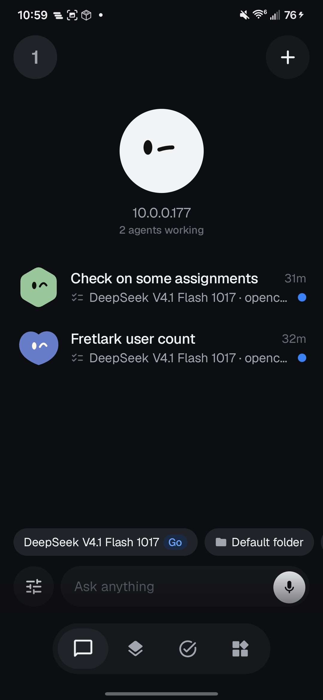

# Parallax

A pocket remote for OpenCode. Talk to your coding agents, queue follow-ups, and approve their next steps from Android.

[Download the Android APK](https://github.com/jscr3ator/Parallax/releases/latest) · Android 10+



**Connect.** Choose OpenCode and scan the QR from `opencode pair --remote`, or sign in with your OpenChamber address and password.

IOS is on the roadmap!

**Web.** Use Parallax from any browser: phone, tablet or laptop. On the computer or Pi that runs your server (Node 18+):

```bash
npx github:jscr3ator/Parallax --backend http://localhost:4096
```

Use `--backend http://localhost:3080` for OpenChamber. Open the address it prints on any device on your network and sign in with your opencode or OpenChamber password. From a clone, `node web/server.mjs` does the same. Add `--port` to change the port (default 8787). The web server stores nothing: chats, projects and folders stay on your server, and the browser keeps only its sign-in token.

**Build.** With JDK 21 and the Android SDK installed, run `./gradlew assembleDebug`.
